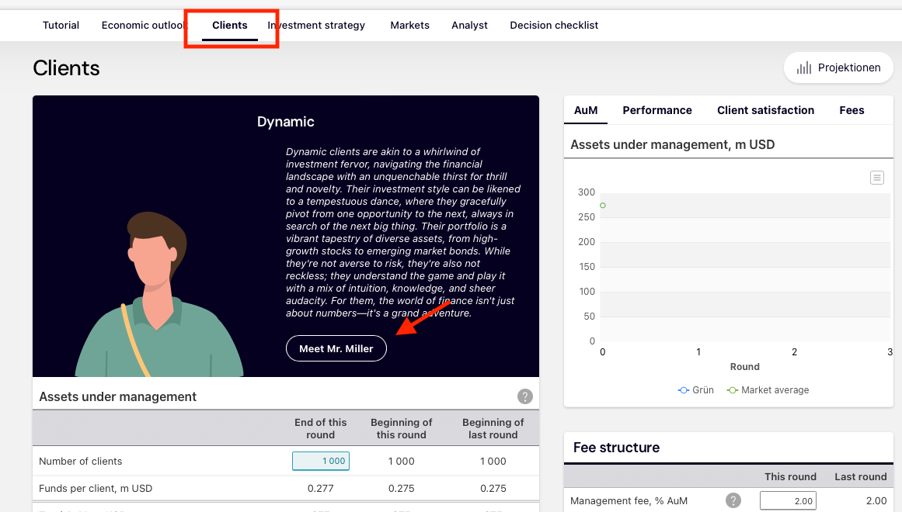

## What We Already Know

- IMAG is played in quarterly rounds with a fixed team submission deadline
- Each fund has its own client mandate, strategic benchmark (SAA) and management fee
- AuM responds to risk-adjusted performance, client satisfaction and fees
- The first step in Round 1 is to translate each client card into exact mathematical inputs

## Learning Outcomes

By the end of this lesson you will be able to:

- Extract a client's investment rules and constraints from the **Clients** page
- Derive a mathematical bracket for risk aversion ($\gamma$) from two past portfolio choices
- Place $\gamma$ inside the bracket using the client's qualitative risk narrative
- Explain why foreign equities are weighted by market capitalisation outside the home market
- Summarise each client in a single specification line for Station 2

# What the Client Card Gives You {background-color="#1e3a5f"}

## The Clients Page in Cesim Invest

{fig-align="center" width="76%"}

## One Number and Two Rules

Every client card contains everything needed for the strategic allocation:

- **One number — Risk aversion ($\gamma$):** not stated as a figure; inferred from two past portfolio decisions
- **Rule 1 — Commodity rule:** either a minimum portfolio floor (e.g. $\ge 5\%$) or an exclusion ($0\%$)
- **Rule 2 — Home-market equity rule:** a fixed share $h$ of the equity book in the client's home market, with the rest allocated across other equity markets by market capitalisation

Some clients also specify a **minimum ESG rating**, and **short sales are never allowed** ($w_i \ge 0$). Whatever the card does not mention is unconstrained.

## Read the Plain Language Literally

| Wording on the Client Card | Mathematical Constraint |
|:--|:--|
| *"Commodities not compatible with their purpose"* | $w_{\text{Commodities}} = 0\%$ (cap of 0) |
| *"About five percent in commodities"* | $w_{\text{Commodities}} \ge 5\%$ (floor of 5%) |
| *"Half of equities in their home market"* | $w_{\text{Home Equity}} = 0.50 \sum_{j \in \text{Equity}} w_j$ |
| *"Rest across other markets in proportion to size"* | Remaining $50\%$ by renormalised market cap |
| *"Cash at the manager's discretion"* | No strategic cash constraint ($0\%$ in SAA) |
: {tbl-colwidths="[52,48]"}

## The Hartley Family Example

Throughout the handbook and slides, we use two invented clients — the **Hartley family** (UK) and the **Keller trust** (Euro area) — to demonstrate the exact method without giving away the game's client numbers.

For the Hartleys, the plain-language rules on the card read:

> *Home market Britain. Commodities at least 5%. Half of the equity book in UK companies, the rest by market size. No sustainability requirement. Cash at the manager's discretion.*

Write these rules down as numbers **before** opening the allocation app.

# Risk Aversion and Utility {background-color="#1e3a5f"}

## Mean–Variance Utility

We model the client as maximising standard Markowitz mean–variance utility:

$$
U = \mu - \frac{\gamma}{2}\sigma^2
$$

- $\mu$: expected excess return over US cash (annualised, in decimals)
- $\sigma$: portfolio return volatility (annualised, in decimals), so $\sigma^2$ is variance
- $\gamma$: **risk aversion coefficient** — how heavily the client penalises variance relative to return

A client prefers portfolio $W$ (winner) over portfolio $L$ (loser) if and only if $U_W > U_L$.

## How One Past Decision Constrains $\gamma$

Suppose the client chose portfolio $W = (\mu_W, \sigma_W)$ over portfolio $L = (\mu_L, \sigma_L)$:

$$
\mu_W - \frac{\gamma}{2}\sigma_W^2 > \mu_L - \frac{\gamma}{2}\sigma_L^2
\quad \Longleftrightarrow \quad
\frac{\gamma}{2}\left(\sigma_L^2 - \sigma_W^2\right) > \mu_L - \mu_W
$$

The direction of the inequality when solving for $\gamma$ depends on the sign of $(\sigma_L^2 - \sigma_W^2)$:

- **Case 1 — Client rejected the riskier portfolio** ($\sigma_L^2 - \sigma_W^2 > 0$): dividing by a positive number preserves $>$, giving a **floor** (lower bound) on $\gamma$.
- **Case 2 — Client chose the riskier portfolio** ($\sigma_L^2 - \sigma_W^2 < 0$): dividing by a negative number flips $>$ to $<$, giving a **ceiling** (upper bound) on $\gamma$.

## The One Formula to Remember

Label the **riskier** portfolio $X = (\mu_X, \sigma_X)$ and the **quieter** portfolio $Y = (\mu_Y, \sigma_Y)$, so $\sigma_X > \sigma_Y$:

$$
\text{bound} = \frac{2(\mu_X - \mu_Y)}{\sigma_X^2 - \sigma_Y^2}
$$

- If the client **rejected** the riskier portfolio $X$ (took quieter $Y$) $\implies \gamma > \text{bound}$ (**Floor**)
- If the client **chose** the riskier portfolio $X$ (took riskier $X$) $\implies \gamma < \text{bound}$ (**Ceiling**)
- **Validity checks:** Verify that $\mu_X > \mu_Y$ (otherwise $X$ is dominated) and put both $\mu$ and $\sigma$ in **annualised decimals** (e.g. $6.9\% = 0.069$).

# Worked Example: Bracketing the Hartleys {background-color="#1e3a5f"}

## Decision 1: Rejecting Risk Gives a Floor

With their previous adviser, the Hartleys were offered two portfolios:

- **Portfolio $X$ (riskier):** $\sigma_X = 10\% = 0.10$, $\mu_X = 6.9\% = 0.069$
- **Portfolio $Y$ (quieter):** $\sigma_Y = 8\% = 0.08$, $\mu_Y = 5.9\% = 0.059$
- **Choice:** They **rejected $X$** and took the quieter portfolio $Y$.

Because they rejected the riskier portfolio, this decision establishes a **lower bound (floor)**:

$$
\gamma > \frac{2(0.069 - 0.059)}{0.10^2 - 0.08^2}
= \frac{2(0.010)}{0.0100 - 0.0064}
= \frac{0.020}{0.0036}
\approx 5.6
$$

## Decision 2: Accepting Risk Gives a Ceiling

Later, the adviser offered a quieter alternative against their existing portfolio:

- **Portfolio $X$ (riskier):** $\sigma_X = 8\% = 0.08$, $\mu_X = 6.6\% = 0.066$
- **Portfolio $Y$ (quieter):** $\sigma_Y = 6\% = 0.06$, $\mu_Y = 5.1\% = 0.051$
- **Choice:** They **stayed with $X$**, the riskier portfolio, and rejected $Y$.

Because they chose the riskier portfolio, this decision establishes an **upper bound (ceiling)**:

$$
\gamma < \frac{2(0.066 - 0.051)}{0.08^2 - 0.06^2}
= \frac{2(0.015)}{0.0064 - 0.0036}
= \frac{0.030}{0.0028}
\approx 10.7
$$

## Placing $\gamma$ Inside the Bracket

Combining both decisions gives **$5.6 < \gamma < 10.7$** (roughly $5.5$ to $11$). The card's qualitative narrative places $\gamma$ inside this bracket:

| Narrative Clue on the Client Card | Placement in Bracket |
|:--|:--|
| *"Need the portfolio to grow; income covers spending"* | **Lower end** (growth priority, higher risk tolerance) |
| *"Lived through two bear markets, would not want the worst again"* | **Middle** (balanced return vs. drawdown) |
| *"Income matters more than growth"* | **Higher end** (capital preservation priority) |
: {tbl-colwidths="[55,45]"}

For the Hartleys, the bear-market comment points to the middle $\implies$ we select **$\gamma = 8$**.

# From $\gamma$ to the Portfolio {background-color="#1e3a5f"}

## What $\gamma$ Does in the Rest of the Course

Once estimated, $\gamma$ serves two quantitative roles:

1. **Selects the Strategic Allocation (Chapter 4 / Station 2):** picks the portfolio on the constrained efficient frontier that maximises $U = \mu - \frac{\gamma}{2}\sigma^2$.
2. **Sets the Black–Litterman Prior (Chapters 5–6 / Station 3):** reverse-optimises the SAA into implied equilibrium returns $\Pi = \gamma \Sigma w_{\text{SAA}}$.

- **Why accuracy matters:** For the Hartleys, choosing $\gamma = 7$ or $9$ instead of $8$ puts the SAA **5.5 to 7 percentage points** away from the hidden benchmark; the ends of the bracket cost **14 to 23 points**.

## Guidance Bands: Your Built-In Check

- **Guidance bands** are stated on the card (e.g. *"between 15 and 52 percent in government bonds"*)
- They are mathematically consistent with the client's $\gamma$ bracket:
  - Every $\gamma$ **inside** the bracket produces an SAA inside the guidance bands
  - A $\gamma$ **outside** the bracket violates at least one guidance band
- Use them two ways:
  1. **To verify your SAA** in Station 2
  2. **To narrow your $\gamma$ estimate** if your initial choice pushes an asset class near or outside a band

# The Home-Market Equity Rule {background-color="#1e3a5f"}

## Home Bias + Capitalisation Weighting

- **Meet client X** names the client's home equity market and home share $h$ (e.g. $h = 50\%$ in UK equities)
- The remaining $(1 - h)$ of the equity book is allocated across the other four equity markets in proportion to their **market capitalisation**:
  - Universe market-cap weights: **US 70.0% · Euro area 14.5% · Japan 5.9% · Switzerland 5.7% · UK 4.0%** (renormalised after removing the home market)
- Because the home rule forces a large share of equities into one country/currency, the optimiser adjusts the rest of the portfolio around it: **two clients with the same $\gamma$ but different home markets will not hold the same asset-class mix**.

## Why Weight Foreign Equities by Market Size?

1. **No invented views:** The client states a home preference (French & Poterba, 1991) but no view on foreign regions. Market cap is the CAPM market portfolio (Sharpe, 1964) — the only weighting that requires no return forecast (Sharpe, 1991).
2. **Protection from optimiser error-maximisation:** Historical mean differences across the five equity markets are noisy; unconstrained MVO turns estimation error into extreme corner weights, often setting entire markets to zero (Michaud, 1989).
3. **Black–Litterman consistency:** Keeping foreign regions at market weights ensures the reverse-optimised prior in Chapters 5–6 stays close to a global CAPM equilibrium (Black & Litterman, 1992).
4. **Trade-off:** Concentration — the US is 70% of the global equity universe, and cap weights follow markets into bubbles (e.g. Japan in 1989).

# Sustainability & Deliverable {background-color="#1e3a5f"}

## Where Sustainability Binds

- A client with an ESG requirement holds only securities meeting the **minimum ESG rating**
- In IMAG, ESG ratings apply to individual securities, and the filter **does not alter the class-level historical statistics** in Station 1
- Therefore:
  - Sustainability **does not change the Station 2 SAA calculation** (beyond any stated commodity exclusion and $\gamma$)
  - It binds in **Chapter 7 (*Automation preferences*)**, when segment weights become security positions

## Simulation Task — Lesson 2

::: {.callout-important}
## Deliverable: One Client Specification Line per Fund

For every active fund, read the **Clients** page and record in your **team forum**:

1. **Bracket $\gamma$:** Record $(\mu_X, \sigma_X)$ and $(\mu_Y, \sigma_Y)$ from the two past choices and compute the floor and ceiling.
2. **Place $\gamma$:** Cite the narrative clue on the card that selects your integer $\gamma$ inside the bracket.
3. **Rules & bands:** Record the commodity rule, home market & share $h$, ESG floor, and guidance bands.
4. **One-line summary:** e.g. *Hartley, home UK: $\gamma \approx 8$ (5.5–11), commodities $\ge 5\%$, 50% UK equities, no ESG floor.*
:::

## Key Takeaways

- Read client rules literally: **do not invent constraints** the client card does not state
- **One formula** brackets $\gamma$: rejecting the riskier portfolio gives a **floor** ($\gamma > \text{bound}$); choosing it gives a **ceiling** ($\gamma < \text{bound}$)
- The narrative places $\gamma$ inside the bracket, and the **guidance bands** verify that your $\gamma$ is calibrated
- Fixing non-home equities by **market capitalisation** prevents MVO noise-chasing and leaves $\gamma$ as the single number you must get right
