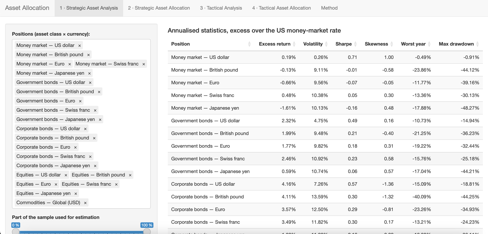

## What We Already Know

- Each client card gives us a risk aversion estimate ($\gamma$), a commodity rule, a home-market equity rule and guidance bands
- The strategic allocation (**SAA**) becomes the fund's fixed benchmark for the entire game
- Client satisfaction and attribution depend on building the SAA on the exact benchmark universe
- Before optimising in Station 2, we must understand the historical return and risk structure of the market

## Learning Outcomes

By the end of this lesson you will be able to:

- Distinguish the long-run historical dataset (strategic input) from the round-by-round Economic outlook (tactical input)
- Read and interpret Station 1's annualised excess-return statistics and correlation matrix
- Explain why unhedged foreign bonds and money markets behave primarily like currency exposures in USD
- Identify the diversification and defensive relationships that drive the efficient frontier

# Two Sources of Market Information {background-color="#1e3a5f"}

## Keep Strategic History and Tactical Outlook Apart

| Information Source | Data & Horizon | Used For |
|:--|:--|:--|
| **Course History** (App) | Full monthly history of the 21 positions in unhedged USD | **Strategic Allocation (SAA)** — Ch. 3–4 (Stations 1–2) |
| **Economic Outlook** (Game) | Next-quarter analyst forecasts (rates, inflation, spreads, factors) | **Tactical Allocation (TAA)** — Ch. 5–6 (Stations 3–4) |
: {tbl-colwidths="[24,42,34]"}

- **Core discipline:** Keep the two strictly separate — the strategic benchmark **never moves** with the current round's Economic outlook.

# Station 1: Strategic Asset Analysis {background-color="#1e3a5f"}

## Inside Station 1 of the Allocation App

{fig-align="center" width="76%"}

## How to Configure Station 1

1. Open <https://inno.uni.li/apps/invest/> and select **1 · Strategic Asset Analysis**
2. Keep the default selection of **16 benchmark positions** (Government bonds, Corporate bonds and Equities in USD, GBP, EUR, CHF, JPY, plus Global Commodities in USD)
3. Keep the estimation window at **100% (full history)**
4. Temporarily add the **5 money-market positions** only when you want to inspect pure currency risk; remove them again before moving to Station 2

All figures in the table are **annualised** ($\mu_{\text{ann}} = 12\mu_{\text{m}}$, $\sigma_{\text{ann}} = \sqrt{12}\sigma_{\text{m}}$) and measured **in excess of the US money-market rate**.

# Three Lessons from the Statistics Table {background-color="#1e3a5f"}

## 1. Ranking by the Sharpe Ratio

Sort the Station 1 table by the **Sharpe ratio** column from top to bottom:

$$
\text{Sharpe ratio} = \frac{\text{Annualised expected excess return }(\mu)}{\text{Annualised volatility }(\sigma)}
$$

- **At the top:** Equity markets and **USD** bond positions (e.g. USD Corporate bonds Sharpe $\approx 0.57$, USD Government bonds Sharpe $\approx 0.49$)
- **Near the bottom:** Non-USD government and corporate bonds, and foreign money-market positions (several with Sharpe ratios near zero or negative)
- **Key question to ask:** *What risk premium is this position actually being paid for, and why does its volatility look so high in dollars?*

## 2. What a Foreign Bond Is in US Dollars

| Position (unhedged USD) | Excess Return | Volatility | Sharpe | Primary Driver in USD |
|:--|:--:|--:|--:|:--|
| **Money market — GBP** | $-0.13\%$ | $9.11\%$ | $-0.01$ | Pure GBP/USD exchange-rate risk |
| **Govt bonds — GBP** | $1.99\%$ | $9.48\%$ | $0.21$ | Same GBP/USD risk + bond term premium |
| **Govt bonds — EUR** | $1.77\%$ | $9.82\%$ | $0.18$ | EUR/USD FX risk + bond term premium |
| **Govt bonds — USD** | $2.32\%$ | $4.75\%$ | $0.49$ | Pure interest-rate risk (zero FX risk) |
: {tbl-colwidths="[26,14,13,11,36]"}

- Because the game **cannot hedge currencies**, a foreign bond is mostly a **currency position** (~9.5% FX volatility) — which is why Station 2 puts the defensive bond book into **USD bonds**.

## 3. Correlation Structure & Defensive Assets

Inspect the correlation matrix in Station 1:

- **Global equity co-movement:**
  - The five equity markets move together, with correlations around **0.40 to 0.65** against US equities
  - Spreading equities across regions diversifies idiosyncratic regional shocks, but still leaves common global equity risk
- **The defensive anchor:**
  - **USD government bonds are slightly negatively correlated with US equities**
  - A negatively correlated asset reduces total portfolio variance ($w^\mathsf{T}\Sigma w$) and cushions equity drawdowns — that is what a defensive position is for, even if its standalone return is lower than equities

# Where the Money Market Fits {background-color="#1e3a5f"}

## The Zero Reference Line

- Excess returns are defined relative to the **US money-market rate**, making USD cash the zero baseline of the table
- Foreign money-market positions earn roughly zero local excess return, so in USD they isolate **pure exchange-rate risk and carry**
- Why money markets are excluded from the SAA:
  - The game's strategic allocation grid has **no cash row**
  - The client leaves cash management to the manager's tactical discretion
  - Including USD cash in an unconstrained minimum-variance or Sharpe optimisation would distort the 16-position benchmark

# What Not to Do Here {background-color="#1e3a5f"}

## Preserve the Integrity of the Strategic Input

- **Do not shift historical means or volatilities** to reflect your personal market forecast — views belong in Chapter 5 (Station 3)
- **Do not shorten the sample window** (keep the slider at 100%) — the game's hidden optimal benchmark is defined on the **full history**; a shorter window changes every input and lowers your client satisfaction score
- **Do not drop unattractive benchmark positions** from the 16-position list — letting the optimiser assign a $0\%$ weight is right; dropping a position corrupts the benchmark universe used later in attribution

## Simulation Task — Lesson 3

::: {.callout-important}
## Deliverable: Market Structure & Risk Diagnosis

Using **Station 1** (<https://inno.uni.li/apps/invest/>), record the following in your **team forum**:

1. **Sharpe Ranking:** With the 16 benchmark positions at 100% sample, sort by Sharpe ratio and list the top 5 and bottom 5 positions.
2. **Unhedged FX Check:** Temporarily add the 5 money-market positions and compare their USD volatility and correlation with each country's government bonds.
3. **Defensive Correlation:** Record the correlation between **US Equities** and **USD Govt Bonds**, and the range of correlations across the 5 equity markets.
4. **Reset for Station 2:** Remove the 5 money-market positions so only the **16 benchmark positions (100% sample)** remain selected.
:::

## Key Takeaways

- **Historical data** defines the fixed SAA benchmark; the **Economic outlook** is reserved for tactical tilts
- All returns are in **unhedged US dollars**: foreign bonds carry ~9–11% currency volatility and are not low-risk defensive anchors for a USD-measured fund
- **USD government bonds** provide both lower volatility and negative correlation to equities, making them the primary defensive building block
- Always keep the **full 16-position universe** and **100% historical sample** when moving to Station 2
