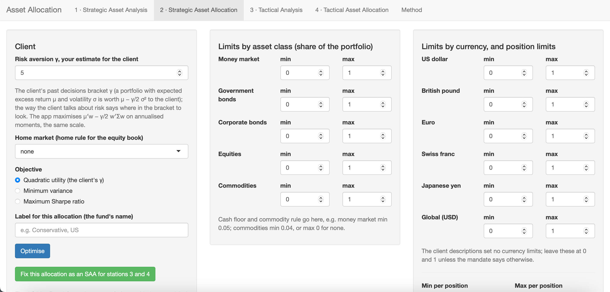
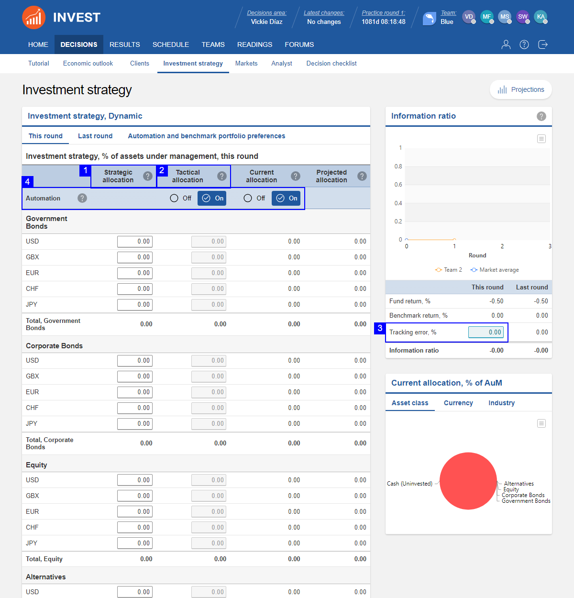

## What We Already Know

- The client card gives us $\gamma$, the commodity rule, the home-market equity rule and guidance bands
- Station 1 gives us the full-history excess returns ($\mu$) and covariance matrix ($\Sigma$) of the 16 benchmark positions in unhedged USD
- The strategic asset allocation (**SAA**) becomes the fund's fixed benchmark for the entire game
- We now combine the client inputs and market history in Station 2 to solve for the optimal benchmark

## Learning Outcomes

By the end of this lesson you will be able to:

- Formulate the constrained mean–variance optimisation problem that defines each client's SAA
- Configure **Station 2** of the allocation app with the exact client parameters and limits
- Validate the resulting SAA against client rules, guidance bands and drawdown expectations
- Quantify the allocation cost of misestimating $\gamma$
- Fix the SAA in the app and enter the currency $\times$ asset-class matrix in Cesim Invest

# What the SAA Is {background-color="#1e3a5f"}

## The Benchmark for the Whole Game

The strategic asset allocation (**SAA**) is:

- Entered **once per fund** in Round 1 on **Investment strategy → Strategic allocation**
- The **benchmark** against which risk-adjusted performance, tracking error and attribution are measured
- The equilibrium reference point ($\Pi = \gamma\Sigma w_{\text{SAA}}$) for every tactical decision in Chapters 5–6
- Evaluated directly on the **Analyst** page against the game's hidden optimal allocation for the client

Your task is not to guess weights by intuition — it is to estimate $\gamma$ accurately (Chapter 2) and run the exact quadratic programme on the full historical dataset.

## The Exact Quadratic Programme

Station 2 solves the Markowitz (1952) quadratic utility problem over the 16 benchmark positions:

$$
\max_{w \in \mathbb{R}^{16}} \quad w^\mathsf{T}\mu - \frac{\gamma}{2}w^\mathsf{T}\Sigma w
$$

- **Full investment & long-only:** $\sum_{i=1}^{16} w_i = 1, \quad w_i \ge 0$ (no money market in the SAA)
- **Commodity rule:** $w_{\text{Commodities}} \ge c_{\min}$ (or $w_{\text{Commodities}} = 0$ if excluded)
- **Home-market equity rule:** $w_x = (1 - h)\, s_x \sum_{j \in \text{Equity}} w_j$ for each foreign equity market $x$, where $h$ is the home share and $s_x$ is market $x$'s renormalised market-cap share
- **Rounding:** weights are rounded to $0.5\%$, with any residual placed in the home equity position

## Annualised Inputs & Portfolio Variance

- Inputs are computed from the **full monthly history** in unhedged USD over the US money-market rate:
  $$
  \mu_{\text{annual}} = 12\,\mu_{\text{monthly}},
  \qquad
  \Sigma_{\text{annual}} = 12\,\Sigma_{\text{monthly}}
  $$
- Portfolio variance depends on all pairwise covariances, not just standalone volatilities:
  $$
  \sigma_p^2 = w^\mathsf{T}\Sigma w = \sum_{i=1}^{16} w_i^2 \sigma_i^2 + \sum_{i=1}^{16}\sum_{j \neq i} w_i w_j \sigma_{ij}
  $$
- Assets with low or negative covariance (such as USD government bonds against equities) reduce $w^\mathsf{T}\Sigma w$ without sacrificing expected return proportionally.

# Mean–Variance Optimisation {background-color="#1e3a5f"}

## The Efficient Frontier

:::: {.columns}
::: {.column width="42%"}
- Plot every feasible portfolio by volatility ($\sigma_p$) and expected excess return ($\mu_p$)
- The upper-left boundary is the **efficient frontier**; any portfolio below it is dominated
- The client's $\gamma$ selects the single point on the frontier that maximises $U = \mu - \frac{\gamma}{2}\sigma^2$:
  - **Higher $\gamma$** $\implies$ lower volatility, lower return
  - **Lower $\gamma$** $\implies$ higher risk, higher return
:::
::: {.column width="58%"}
{fig-align="center"}
:::
::::

## Two Consequences for Checking the Output

1. **An SAA is a long-run risk–return trade-off, not a next-quarter forecast:**
   - It answers *"given historical means/covariances and this $\gamma$, what portfolio maximises expected utility?"* — not *"which asset class will rally next quarter?"*
2. **MVO is highly sensitive to inputs:**
   - Small changes in $\mu$, $\Sigma$, or constraints can shift weights sharply and leave many positions at zero
   - Always inspect both what receives positive weight and **what the optimiser sets to zero**

# Station 2: Step by Step {background-color="#1e3a5f"}

## Inside Station 2 of the Allocation App

{fig-align="center" width="76%"}

## Configuring Station 2

1. **Client box:**
   - Enter your point estimate of $\gamma$ (whole number)
   - Select the **Home market** from *Meet client X* and enter the stated **Share at home** ($h$)
   - Set **Objective** to *Quadratic utility* and give the run a clear **Label** (e.g. `Hartley, UK`)
2. **Limits by asset class:**
   - Set **Commodities** min = client floor (e.g. `0.05`), or max = `0` if excluded
   - Leave all other asset-class, currency and position limits at `0` and `1` unless stated on the card
3. **Optimise & Fix:**
   - Click **Optimise**, verify the 5 checks below, click **Fix this allocation as an SAA**, and **Save** the session JSON

# Hartley Worked Example {background-color="#1e3a5f"}

## Hartley Optimal SAA Matrix ($\gamma = 8$, Home UK 50%, Comm $\ge 5\%$)

| Asset Class | USD | GBP | EUR | CHF | JPY | **Total** |
|:--|--:|--:|--:|--:|--:|--:|
| **Government bonds** | 38.0 | 0.0 | 0.0 | 0.0 | 0.0 | **38.0** |
| **Corporate bonds** | 10.5 | 0.0 | 0.0 | 0.0 | 0.0 | **10.5** |
| **Equities** | 17.0 | 23.0 | 3.5 | 1.5 | 1.5 | **46.5** |
| **Commodities** | 5.0 | 0.0 | 0.0 | 0.0 | 0.0 | **5.0** |
| **Total (%)** | **70.5** | **23.0** | **3.5** | **1.5** | **1.5** | **100.0** |
: {tbl-colwidths="[28,12,12,12,12,12,12]"}

- **In-sample stats:** Excess return **6.4%**, volatility **7.5%**, Sharpe **0.85**, worst calendar year **−13.9%**, max drawdown **−22%**. Binding limit: commodity floor ($5.0\%$).

## Reading the Matrix as the Client

:::: {.columns}
::: {.column width="62%"}
- **Defensive book is 100% in USD:** $38.0\%$ USD govt bonds + $10.5\%$ USD corp bonds (GBP bonds carry $\sim 9.5\%$ FX volatility with low Sharpe).
- **Equity book ($46.5\%$ total):** Half is UK ($23.0\%$); the other $23.5\%$ follows world market cap (US $17.0\%$, EUR $3.5\%$, CHF $1.5\%$, JPY $1.5\%$).
- **Everything not required or rewarded is zero:** Foreign bonds are all $0\%$; commodities sit at the $5.0\%$ floor.
:::
::: {.column width="38%"}
{fig-align="center" width="72%"}
:::
::::

# Five Checks Before You Fix the SAA {background-color="#1e3a5f"}

## Verify Every Output Before Entering It

1. **Stated rules met, nothing else binds:** In Station 2's *Binding limits*, only the client's stated floor/cap (e.g. commodity floor) should appear.
2. **Inside all guidance bands:** Hartley bands are Govt bonds **15–52%** ($38.0\%$), Corp bonds **6–18%** ($10.5\%$), Equities **37–63%** ($46.5\%$). Outside a band $\implies \gamma$ is outside the bracket!
3. **Home equity share matches the card:** Within $\pm 1\%$ due to $0.5\%$ rounding.
4. **Plausible downside risk:** Worst year of **−13.9%** fits the Hartley bear-market comment, whereas **−23%** ($\gamma = 5.5$) does not.
5. **Inspect what is zero:** If a near-zero Sharpe position from Station 1 appears with positive weight, check which limit is forcing it.

# What a Wrong $\gamma$ Costs {background-color="#1e3a5f"}

## Sensitivity Across the Hartley Bracket

| Metric | $\gamma=5.5$ | $\gamma=6$ | $\gamma=7$ | **$\gamma=8$** | $\gamma=9$ | $\gamma=10$ | $\gamma=11$ |
|:--|--:|--:|--:|--:|--:|--:|--:|
| **Equities (%)** | 62.5 | 58.5 | 51.5 | **46.5** | 43.0 | 40.0 | 37.0 |
| **Government bonds (%)** | 15.0 | 21.0 | 31.0 | **38.0** | 43.5 | 48.0 | 52.0 |
| **Volatility (%)** | 10.0 | 9.4 | 8.3 | **7.5** | 7.0 | 6.6 | 6.2 |
| **Worst calendar year (%)** | −23 | −21 | −17 | **−14** | −12 | −10 | −8 |
| **Distance to $\gamma=8$ (pts)** | **23.0** | **17.0** | **7.0** | **0.0** | **5.5** | **10.0** | **14.0** |
: {tbl-colwidths="[26,10,10,10,12,10,11,11]"}

- Off by **1 unit in $\gamma$** costs **5.5–7 points** of allocation distance; bracket edges cost **14–23 points** (matching the guidance band edges: $37\text{–}63\%$ equities, $15\text{–}52\%$ govt bonds).

# Four Traps to Avoid {background-color="#1e3a5f"}

## Do Not Alter the Benchmark Problem

1. **Using Maximum Sharpe or Minimum Variance:** Neither represents the client's utility function; both ignore $\gamma$ (and collapse into cash if money markets are selected). Use **Quadratic utility** only.
2. **Shortening the sample window:** The game's benchmark parameters are computed on 100% of the historical sample.
3. **Inventing unstated limits:** Adding a home-currency bond floor, a regional cap, or a cash floor pushes your SAA away from the hidden benchmark and hurts client satisfaction.
4. **Transposing or mis-entering the grid:** In Cesim Invest (*Investment strategy → Strategic allocation*), columns are **currencies** and rows are **asset classes**. Put Commodities in the **USD / Alternatives** cell and verify that every row and column sum matches Station 2.

## Simulation Task — Lesson 4

::: {.callout-important}
## Deliverable: Fixed SAA per Fund in App & Game

1. **Run Station 2:** Enter your integer $\gamma$, home market, home share $h$, quadratic utility, and commodity rule on the 16-position full sample.
2. **Verify the 5 Checks:** Confirm only stated rules bind, all classes sit inside **guidance bands**, and worst year matches the narrative.
3. **Fix & Save JSON:** Click **Fix this allocation as an SAA** for each fund and **Save** the `.json` session file to the team forum.
4. **Enter in Cesim Invest:** Type the rounded weights into *Investment strategy → Strategic allocation* and copy to the **Team Decision Area**.
:::

## Key Takeaways

- The SAA is a **fixed long-run benchmark** solved via constrained quadratic utility — set it once in Round 1 and leave it unchanged unless the Analyst page flags an overweight/underweight
- Non-home equities follow renormalised **market-cap weights** via linear equality constraints
- Guidance bands and worst-year drawdowns cross-check your choice of $\gamma$ inside the bracket
- Save your **Station 2 JSON file** — Stations 3 and 4 build directly on your fixed SAAs in every round
