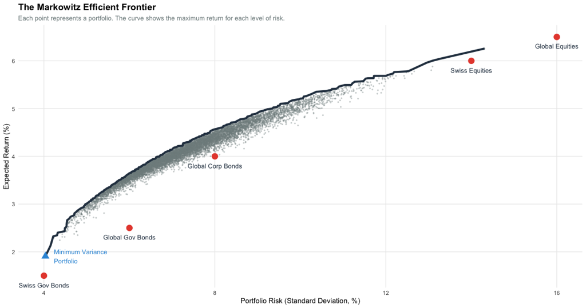

## Learning Outcomes

By the end of this lesson you will be able to:

- Explain the constrained mean–variance optimisation that defines each fund's **SAA benchmark**
- Configure **Station 2** with the client's $\gamma$, home-market rule, and commodity limit
- Validate the SAA against guidance bands, downside risk, and $\gamma$ sensitivity
- Fix the SAA in the app, save the session `.json`, and enter the grid in Cesim Invest

# Mean–Variance Optimisation & The SAA {background-color="#1e3a5f"}

## The Exact Benchmark Problem

The SAA is entered **once in Round 1** as the fund's permanent benchmark. Station 2 solves (Markowitz, 1952):

$$
\max_{w \in \mathbb{R}^{16}} \quad w^\mathsf{T}\mu - \frac{\gamma}{2}w^\mathsf{T}\Sigma w
$$

- **Inputs:** Full-history annualised excess returns ($\mu = 12\mu_m$) and covariance ($\Sigma = 12\Sigma_m$) in unhedged USD
- **Standard constraints:** $\sum_{i=1}^{16} w_i = 1, \; w_i \ge 0$ (16 benchmark segments; no money market; rounded to $0.5\%$)
- **Client rules:** Commodity floor/cap + linear home-equity equality for each foreign market $x$:
  $$w_x = (1 - h)\, s_x \sum_{j \in \text{Equity}} w_j$$

## The Efficient Frontier

:::: {.columns}
::: {.column width="42%"}
- Upper-left boundary of feasible portfolios in $(\sigma_p, \mu_p)$ space
- $\gamma$ selects the tangency portfolio maximising $U = \mu - \frac{\gamma}{2}\sigma^2$:
  - **Higher $\gamma$** $\implies$ more USD govt bonds
  - **Lower $\gamma$** $\implies$ more equities
- **Not a next-quarter forecast:** it is the long-run equilibrium trade-off for this client
:::
::: {.column width="58%"}
{fig-align="center"}
:::
::::

# Station 2 & Hartley Example {background-color="#1e3a5f"}

## Inside Station 2 of the Allocation App

{fig-align="center"}

## Hartley Optimal SAA Matrix ($\gamma = 8$, UK 50%, Comm $\ge 5\%$)

| Asset Class | USD | GBP | EUR | CHF | JPY | **Total** |
|:--|--:|--:|--:|--:|--:|--:|
| **Government bonds** | 38.0 | 0.0 | 0.0 | 0.0 | 0.0 | **38.0** |
| **Corporate bonds** | 10.5 | 0.0 | 0.0 | 0.0 | 0.0 | **10.5** |
| **Equities** | 17.0 | 23.0 | 3.5 | 1.5 | 1.5 | **46.5** |
| **Commodities** | 5.0 | 0.0 | 0.0 | 0.0 | 0.0 | **5.0** |
| **Total (%)** | **70.5** | **23.0** | **3.5** | **1.5** | **1.5** | **100.0** |
: {tbl-colwidths="[28,12,12,12,12,12,12]"}

- **In-sample:** Excess return **6.4%**, volatility **7.5%**, Sharpe **0.85**, worst year **−13.9%**, max drawdown **−22%**.

## Reading & Entering the Matrix

:::: {.columns}
::: {.column width="62%"}
- **Defensive book = 100% USD:** $38\%$ USD govt + $10.5\%$ USD corp bonds (avoids unhedged FX volatility)
- **Equity book ($46.5\%$):** Half UK ($23\%$); half world market cap (led by US at $17\%$)
- **Unrewarded/unrequired segments = 0%:** All non-USD bonds are zero; commodities bind at $5\%$
:::
::: {.column width="38%"}
{fig-align="center" width="72%"}
:::
::::

# Validation, Sensitivity & Traps {background-color="#1e3a5f"}

## Five Checks Before Fixing the SAA

1. **Only stated rules bind:** Check *Binding limits* in Station 2
2. **Inside all guidance bands:** Hartley bands: Govt **15–52%** ($38\%$), Corp **6–18%** ($10.5\%$), Equities **37–63%** ($46.5\%$)
3. **Home share preserved:** $23.0 / 46.5 = 49.5\%$ ($\approx 50\%$ after $0.5\%$ rounding)
4. **Plausible worst year:** **−13.9%** fits the Hartley bear-market comment (−23% at $\gamma = 5.5$ does not)
5. **Zero weights make sense:** No low-Sharpe foreign bond appears unless forced by a constraint

## What a Wrong $\gamma$ Costs (Hartley Sensitivity)

| Metric | $\gamma=5.5$ | $\gamma=6$ | $\gamma=7$ | **$\gamma=8$** | $\gamma=9$ | $\gamma=10$ | $\gamma=11$ |
|:--|--:|--:|--:|--:|--:|--:|--:|
| **Equities (%)** | 62.5 | 58.5 | 51.5 | **46.5** | 43.0 | 40.0 | 37.0 |
| **Government bonds (%)** | 15.0 | 21.0 | 31.0 | **38.0** | 43.5 | 48.0 | 52.0 |
| **Volatility (%)** | 10.0 | 9.4 | 8.3 | **7.5** | 7.0 | 6.6 | 6.2 |
| **Worst calendar year (%)** | −23 | −21 | −17 | **−14** | −12 | −10 | −8 |
| **Distance to $\gamma=8$ (pts)** | **23.0** | **17.0** | **7.0** | **0.0** | **5.5** | **10.0** | **14.0** |
: {tbl-colwidths="[26,10,10,10,12,10,11,11]"}

- **1 unit off in $\gamma$** costs **5.5–7 points** of benchmark distance; bracket edges match the guidance band limits.

## Four Traps to Avoid

- **Do not use Max Sharpe or Min Variance:** Always select **Quadratic utility** with the client's $\gamma$
- **Do not shorten the sample:** Keep the slider at **100%**
- **Do not add unstated caps/floors:** Home bond floors or FX caps distort the benchmark
- **Do not mis-enter the grid:** Commodities go in **USD / Alternatives**; verify row and column sums

## Simulation Task — Lesson 4

::: {.callout-important}
## Deliverable: Fixed SAA per Fund in App & Game

1. **Station 2:** Optimise each fund's SAA (Quadratic utility, 16 positions, 100% sample) and verify the 5 checks.
2. **Fix & Save:** Click **Fix this allocation as an SAA** for every fund and **Save** the `.json` file to your team forum.
3. **Cesim Invest:** Enter the SAA matrices under *Investment strategy → Strategic allocation* and copy to the **Team Area**.
:::

## Key Takeaways

- The SAA is your **fixed benchmark** for the whole game — set it accurately in Round 1
- Guidance bands and worst-year drawdowns confirm whether your $\gamma$ is properly placed
- Save your **Station 2 `.json` session** — Stations 3 and 4 need your fixed SAAs every round
