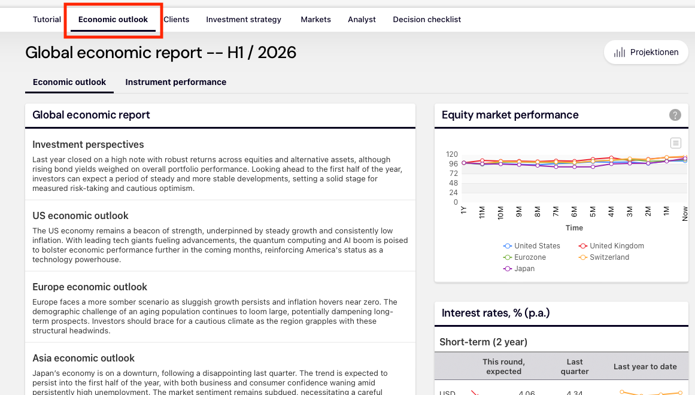
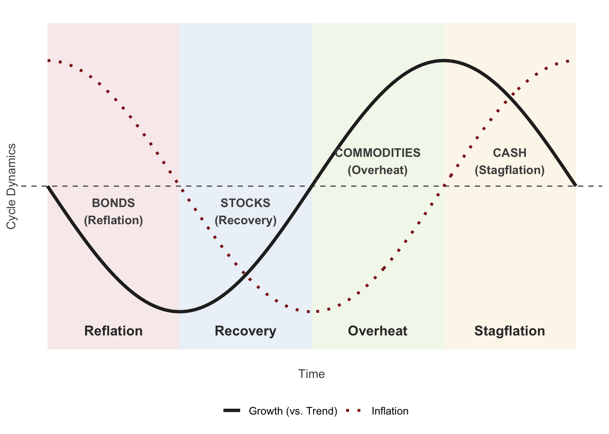
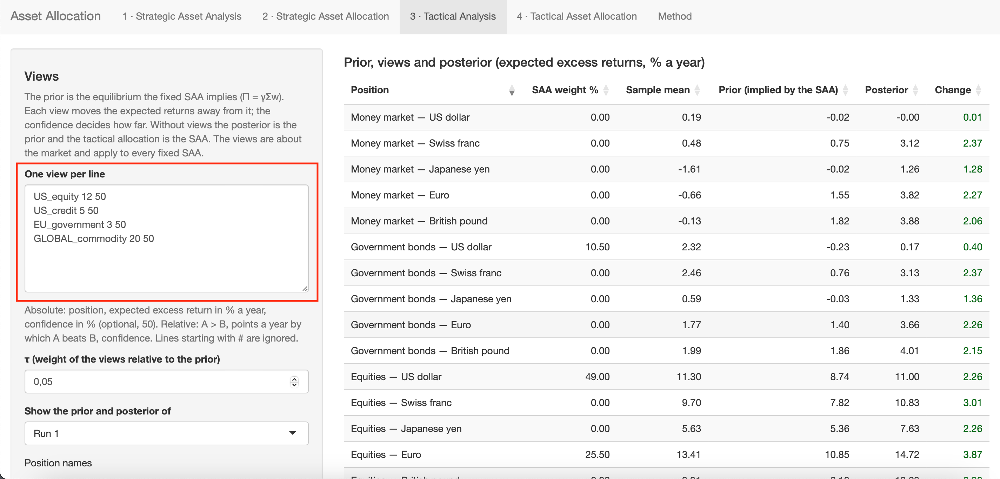
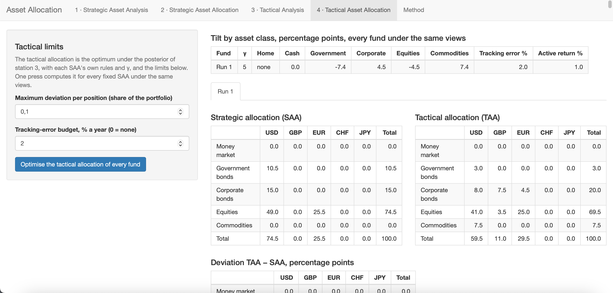

## Learning Outcomes

By the end of this lesson you will be able to:

- Diagnose the business cycle with the **Investment Clock** and cross-check with sectors/factors
- Enter **absolute and relative views** with calibrated confidence in Station 3
- Explain how **Black–Litterman** blends the SAA prior ($\Pi = \gamma\Sigma w$) with your views
- Optimise the **Tactical Asset Allocation (TAA)** in Station 4 under bands and a tracking-error budget
- Configure **ESG automation** and evaluate individual stocks on three fundamental checks

# Part 1: Outlook & The Investment Clock {background-color="#1e3a5f"}

## What the Economic Outlook Gives You

:::: {.columns}
::: {.column width="42%"}
- Published each round with point forecasts and **expected ranges**:
  - Interest rates & credit spreads
  - GDP growth, inflation, unemployment & confidence
  - Market return & factor premia (**HML, MOM, RMW**)
- Diagnose the cycle and express views **only where you disagree with the SAA prior**
:::
::: {.column width="58%"}
{fig-align="center"}
:::
::::

## The Investment Clock (Greetham & Hartnett, 2004)

{fig-align="center"}

## Four Phases & Cross-Checks

| Phase | Growth | Inflation | Favoured Class | US Real Return (1973–2004) |
|:--|:--:|:--:|:--|:--|
| **Reflation** | $\downarrow$ | $\downarrow$ | **Bonds** (rate cuts; yields fall) | Bonds **+9.8%**, Stocks +6.4% |
| **Recovery** | $\uparrow$ | $\downarrow$ | **Stocks** (rebound + low rates) | Stocks **+19.9%**, Bonds +7.0% |
| **Overheat** | $\uparrow$ | $\uparrow$ | **Commodities** (inflation rises) | Comm **+19.7%**, Stocks +6.0% |
| **Stagflation** | $\downarrow$ | $\uparrow$ | **Cash / Real** (no rate cuts) | Cash **−0.3%**, Stocks **−11.7%** |
: {tbl-colwidths="[15,11,11,35,28]"}

- **Cross-check with Sectors & Factors:** Cyclicals/Value (**HML > 0**) confirm Overheat/Recovery; Defensives/Growth confirm Reflation; **MOM > 0** confirms a clean transition ($\ge 2$ confirming signals $\implies 70\text{–}80\%$ confidence).

## Worked Example: Classifying Two Economies

| Indicator | Economy A | Economy B |
|:--|:--|:--|
| **GDP growth (last 4Q)** | Rising steadily | Rising, but slowing over last 2Q |
| **Inflation (vs. 4Q ago)** | $0.6\% \to 1.9\%$ (rising sharply) | $1.4\% \to 1.4\%$ (low and flat) |
| **Unemployment & Confidence** | Unemployment $\downarrow$; confidence $\uparrow$ | Unemployment flat; business conf. $\downarrow$ |
| **Diagnosis & Tilt** | **Overheat:** OW Equities A & Comm; UW Bonds | **Late Recovery:** OW Equities B (cautious); UW Bonds |
: {tbl-colwidths="[28,36,36]"}

# Part 2: Black–Litterman & Station 3 {background-color="#1e3a5f"}

## Station 3: Entering Views

{fig-align="center"}

## View Syntax & Black–Litterman Math

:::: {.columns}
::: {.column width="46%"}
- **Absolute view** (`<pos> <ret_%> [conf_%]`):
  ```text
  US_equity 12 50
  ```
- **Relative view** (`<posA> > <posB> <diff> [conf_%]`):
  ```text
  EU_equity > CH_equity 2 60
  ```
- **One set of views for all funds** (keep $\tau = 0.05$)
:::
::: {.column width="54%"}
- **Prior implied by SAA:** $\Pi = \gamma\Sigma w_{\text{SAA}}$
- **Posterior expected returns:**
  $$E(R) = \left[(\tau\Sigma)^{-1} + P^\mathsf{T}\Omega^{-1}P\right]^{-1}\left[(\tau\Sigma)^{-1}\Pi + P^\mathsf{T}\Omega^{-1}Q\right]$$
- **No views $\implies E(R) = \Pi \implies \text{TAA} = \text{SAA}$**
- Example (`US_equity 12 50` on Hartley): prior $7.5\% \to$ posterior **$9.8\%$** (lifts correlated `UK`/`EU` equities too)
:::
::::

# Part 3: Tactical Allocation in Station 4 {background-color="#1e3a5f"}

## Station 4: Optimising the Tactical Tilt

{fig-align="center"}

## How Station 4 Differs from Station 2

Station 4 maximises $w^\mathsf{T}E(R) - \frac{\gamma}{2}w^\mathsf{T}\Sigma w$ around each fund's fixed SAA with **three modifications**:

1. **No home-market rule:** Allows single-region equity views to act freely (commodity floor still binds)
2. **Sample covariance $\Sigma$ (not $\Sigma_{\text{BL}}$):** Prevents view uncertainty from artificially inflating risk and pushing funds into bonds
3. **Risk controls:** Position band $|w_i - w_{i,\text{SAA}}| \le \mathbf{\pm 5\text{ pts}}$ and tracking-error budget $\text{TE} \le \mathbf{2.0\%\text{/yr}}$

## Hartley TAA Example (`US_equity 12 50`)

| Asset Class | USD | GBP | EUR | CHF | JPY | **Total Tilt (pts)** |
|:--|--:|--:|--:|--:|--:|--:|
| **Government bonds** | −5.0 | 0.0 | 0.0 | 0.0 | 0.0 | **−5.0** |
| **Corporate bonds** | −4.0 | +1.0 | 0.0 | 0.0 | 0.0 | **−3.0** |
| **Equities** | +5.0 | +2.0 | +0.5 | +0.5 | 0.0 | **+8.0** |
| **Commodities** | 0.0 | 0.0 | 0.0 | 0.0 | 0.0 | **0.0** |
| **Total Tilt (pts)** | **−4.0** | **+3.0** | **+0.5** | **+0.5** | **0.0** | **0.0** |
: {tbl-colwidths="[26,12,12,12,12,12,14]"}

- **Hartley ($\gamma = 8$):** $\text{TE} = 1.3\%$, active return $= +0.7\%$. **Keller ($\gamma = 5$):** Lower $\gamma \implies$ larger tilt ($+10\text{ pts}$ equities, $\text{TE} = 1.5\%$, active return $= +1.0\%$).

## Two Tactical Traps

- **Foreign bond view = currency bet:** `EU_government 4 50` shifts $+5\text{ pts}$ into EUR govt and $+5\text{ pts}$ into EUR credit $\implies$ **10-point EUR/USD exposure**. Always check currency column totals!
- **Binding commodity floor:** A bearish commodity view cannot reduce commodities below the client's floor ($5\%$) and may flag a **negative expected active return** — if so, leave the fund at its SAA.

# Part 4: ESG Automation & Security Selection {background-color="#1e3a5f"}

## ESG Automation & Optional Stock Picks

- **Automation first (Round 1 & early rounds):**
  - Set **Minimum criteria → ESG rating → A** for ESG funds in *Automation preferences*
  - Verify the **Matches** column has no warnings (unmatched segments stay in unintended cash!)
  - Keep *Automatic current allocation* **ON** (value weighting) unless you have a stock-level thesis
- **If selecting individual stocks later** (keep segment totals equal to your TAA):

| Check | Metrics on Asset Page | What to Look For |
|:--|:--|:--|
| **1. Earnings Quality** | $\text{FCF/share} \div \text{EPS}$, **ROI vs. ROE** | $\text{FCF/EPS} \approx 1.0$ (cash-backed profit); ROI rising with ROE (not just leverage) |
| **2. Solvency** | **Current Ratio**, **Debt/Equity** | $\text{Current Ratio} > 1.0$ (liquidity); falling D/E (deleveraging) |
| **3. Valuation** | **P/E** vs. **5Y History** & **Market** | Cheap vs. market ($12 < 15$) can still be expensive vs. own history ($12 \text{ vs. } 6.5$)! |
: {tbl-colwidths="[22,26,52]"}

## Simulation Task — Lesson 5

::: {.callout-important}
## Deliverable: Round Views, TAA & ESG Setup

1. **ESG Floor:** Set the ESG rating floor in *Automation preferences* and verify **Matches** is clean.
2. **Views & TAA (Stations 3–4):** Load your SAA `.json`, enter 1–3 views with confidence, and optimise all funds' TAAs.
3. **Enter & Log:** Enter the TAA grids in Cesim, check projected TE/IR, and log views and TAA tilts in the **team forum**.
:::

## Key Takeaways

- Classify the cycle and cross-check with sectors/factors **before** entering views
- Black–Litterman blends the SAA prior ($\Pi = \gamma\Sigma w$) with views — **no views means no tilt**
- Watch currency column totals on foreign views and keep **security automation ON** in early rounds
