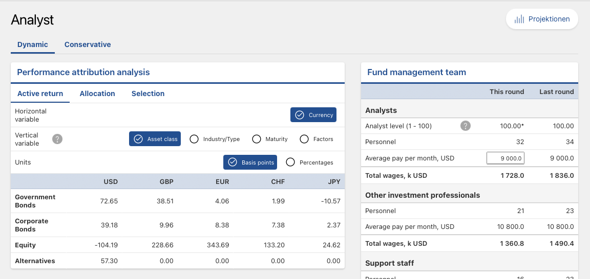

## What We Already Know

- Each fund's **SAA** is its fixed benchmark, and its **TAA** reflects this round's Black–Litterman views
- **ESG floors** and segment-to-security **automation** translate tactical weights into 180 asset holdings
- Before the deadline, we must set **management fees**, run a final consistency check in **Projections**, and copy the agreed setup into the **Team Decision Area**
- After the deadline, we diagnose **Performance Ratios**, **Micro Attribution**, and **SAA Analysis** to drive next round's decisions

## Learning Outcomes

By the end of this lesson you will be able to:

- Calibrate fund management fees by client type and verify pre-submission **Projections**
- Execute the pre-deadline checklist and submit cleanly via the **Team Decision Area**
- Interpret **Sharpe, Sortino, Treynor and Information Ratios** (accounting for before- vs. after-fee definitions)
- Decompose active return via **Micro Attribution** (Allocation vs. Selection; Currency, Asset Class, Industry, Factor)
- Translate round diagnostics into concrete adjustments for the next round

# Part 1: Fees, Projections & Submission {background-color="#1e3a5f"}

## Setting Management Fees

Fees are set per fund on the **Clients** page as an **annual percentage of AuM** (a quarterly round charges one-fourth of the annual rate):

- **The fundamental trade-off:**
  - Higher fees raise immediate revenue per dollar of AuM, **but** reduce client satisfaction and trigger outflows
  - Strong risk-adjusted performance makes clients more fee-tolerant
- **Client segmentation:**
  - **Dynamic clients** respond to marketing and tolerate higher management fees
  - **Conservative clients** expect low, transparent fees
- **Best practice for early rounds:** Set a modest fee differentiated by client type (higher for Dynamic than Conservative) and **hold it steady** — changing fees every round makes it impossible to tell whether AuM flows came from your investment decisions or your fee changes!

## Using Projections as a Pre-Submission Check

Click the **Projections** button (top right of decision screens) before submitting. Treat it as a **consistency check**, not a guaranteed forecast:

1. **Tracking Error alignment:** Does each fund's projected TE in the game roughly match Station 4's output ($1\text{–}3\%$)?
2. **Zero unintended cash:** Does any ESG fund show unexpected cash because an overly strict ESG filter left a segment with 0 matching assets?
3. **Strategy recap:** Do the currency $\times$ asset-class weights shown in Projections match the grids you intended to enter?
4. **Plausible fee revenue & AuM:** Are projected management fees and AuM flows in a sensible range?

## Pre-Deadline Team Submission Checklist

Only the **Team Decision Area** is scored when the round clock expires:

1. **SAA (Round 1 only):** Entered, checked against guidance bands, and untouched in later rounds
2. **TAA (Every round):** Entered for every fund (or *Automatic tactical allocation* deliberately left on if you have no views)
3. **Automation preferences:** ESG floor set for ESG funds; **Matches** column clean
4. **Asset-level automation:** Left **ON** (or manual security deviations documented with segment totals preserved)
5. **Fees & Projections:** Fees set; *Projections* verified
6. **Copy to Team Area:** Round CEO clicks **Copy as team's decisions** (or edits the Team Area directly) and verifies via the **Decision checklist** page
7. **Forum Record:** Views, confidence levels, TAA matrices, projected TE/IR and fees logged in the team forum

# Part 2: Reading Results in the Right Order {background-color="#1e3a5f"}

## Three Questions, Three Sections

When round results are published, read the **Results** and **Analyst** pages in this exact sequence:

| Step | Question | Where to Look | Adjustment Frequency |
|:--:|:--|:--|:--|
| **1** | **Did the tactical tilt work?** | **Performance Ratios** (Active return & IR) | Every round |
| **2** | **Why did it work or fail?** | **Micro Attribution** (*Allocation* vs. *Selection*) | Every round |
| **3** | **Is the benchmark right?** | **Strategic Allocation Analysis** (*Analyst* page) | **Once** (if $\gamma$ is off) |
: {tbl-colwidths="[8,32,38,22]"}

# Performance Ratios & Factor Loadings {background-color="#1e3a5f"}

## The Four Performance Ratios

| Ratio | Formula | What It Measures & How to Read It |
|:--|:--|:--|
| **Sharpe Ratio** | $(R_p - R_f) / \sigma_p$ | Excess return per unit of **total volatility** ($\sigma_p$). Penalises upside and downside swings equally. |
| **Sortino Ratio** | $(R_p - R_f) / \sigma_{\text{down}}$ | Excess return per unit of **downside volatility**. Higher than Sharpe when returns are positively skewed. |
| **Treynor Ratio** | $(R_p - R_f) / \beta_p$ | Excess return per unit of **market beta** ($\beta_p$). *Note:* negative if $\beta_p < 0$ even when $R_p > R_f$. |
| **Information Ratio** | $(R_p - R_b) / \text{TE}_{p,b}$ | **Active return** per unit of **tracking error**. The primary measure of tactical skill in Station 4. |
: {tbl-colwidths="[20,22,58]"}

## Crucial Caveat: Before- vs. After-Fee Information Ratio

::: {.callout-warning}
## How Cesim Computes the Information Ratio
Cesim Invest's reported **Information Ratio** compares the fund's return **after fees** against the benchmark's return **before fees**.
:::

- **What this means in practice:**
  - A fund charging a $1.6\%$ annual fee ($0.40\%$ per quarter) will display a **negative IR** whenever its tactical tilt adds less than $+0.40\%$ in that quarter — even if the tilt beat the benchmark before fees!
  - **Rule for judging your views:** Always compare the fund's **before-fee return** against the **benchmark return** on the *Results* page to evaluate whether your Station 3 views added value.

## Factor Coefficients & Strategic Allocation Analysis

- **Four-Factor Regression Coefficients (Analyst Page):**
  - **Alpha ($\alpha$):** Return unexplained by systematic factors (positive = skill / unmodelled value added)
  - **Market Beta ($\beta_{\text{MKT}}$):** Market sensitivity ($<0$ means the fund acts as a macro hedge)
  - **HML Beta:** Value ($>0$) vs. Growth ($<0$) tilt
  - **MOM Beta:** Momentum ($>0$) vs. Contrarian ($<0$) tilt
  - **RMW Beta:** Robust profitability / Quality ($>0$) vs. Junk ($<0$) tilt
- **Strategic Allocation Analysis (Bottom of Analyst Page):**
  - **"Balanced allocation"** $\implies$ Your $\gamma$ is well calibrated; **do not touch the SAA**
  - **"Overweighted" in Equities** $\implies$ Your $\gamma$ is **too low**; raise $\gamma$ in Station 2 and update the SAA **once**
  - **"Overweighted" in Govt Bonds** $\implies$ Your $\gamma$ is **too high**; lower $\gamma$ in Station 2 and update the SAA **once**

# Part 3: Micro Attribution {background-color="#1e3a5f"}

## Inside the Analyst Attribution Tabs

{fig-align="center" width="76%"}

## Diagnosing Active Return in Three Questions

The Analyst page splits active return ($R_p - R_b$) into **Allocation** (your tactical segment tilts in Station 4) and **Selection** (which securities were held inside each segment):

1. **Was it Allocation or Selection?**
   - Negative Allocation + zero Selection $\implies$ **Tactical tilt (views) went wrong**
   - Zero Allocation + negative Selection $\implies$ **Security selection (or ESG filter drift) went wrong**
2. **Was it Currency or Asset Class?** (inside the *Allocation* tab)
   - Large negative Currency effect + small Asset Class effect $\implies$ **Unhedged FX bet hurt you** (e.g. overweight EUR bonds when EUR depreciated against USD)
3. **Was it Industry, Maturity, or Factor?** (inside the *Selection* tab)
   - Isolates which sector bet, bond duration tilt, or style factor drove security-level performance

## Worked Diagnosis: The Orange Fund

:::: {.columns}
::: {.column width="46%"}
| Tab | Category | Effect |
|:--|:--|--:|
| **Allocation** | Currency | **−0.5%** |
| **Allocation** | Asset class | **−0.1%** |
| **Selection** | Industry | **−0.2%** |
| **Selection** | Factor | **0.0%** |
| **Total Active** | | **−0.8%** |
: {tbl-colwidths="[36,38,26]"}
:::
::: {.column width="54%"}
- **Diagnosis:** Allocation is **−0.6%** (dominated by **Currency at −0.5%**); Selection is **−0.2%** (Industry).
- **Next-round action:**
  1. **Fix the currency bet first:** Revisit the Station 3 view that created the foreign-currency tilt; drop it, lower confidence, or express it relative to USD bonds.
  2. **Ignore the −0.2% industry effect** if automatic allocation is on (normal cap-weighting noise).
:::
::::

# Part 4: Process vs. Outcome & Feedback Loop {background-color="#1e3a5f"}

## Actionable Playbook (1/2): Ratio Signals

| Observed Signal | Diagnosis | Action for the Next Round |
|:--|:--|:--|
| **Before-fee IR < 0** | Tactical tilt detracted value | Use fewer views, lower confidence, or narrow band/TE budget. Drop any view that fails 3 rounds in a row. |
| **Before-fee IR 0 to 0.5** | Views added modest value | Keep the process; lower view confidence slightly if high-confidence views only produce small gains. |
| **Before-fee IR > 0.5** | Views were well calibrated | **Keep the process unchanged.** Do not widen the TE budget out of overconfidence. |
| **High Sharpe, IR $\approx 0$** | SAA worked; tilts added nothing | Check whether views cancelled out; either state clearer views or leave TAA equal to SAA. |
: {tbl-colwidths="[22,26,52]"}

## Actionable Playbook (2/2): Skew, SAA & Satisfaction

| Observed Signal | Diagnosis | Action for the Next Round |
|:--|:--|:--|
| **Sortino $\ll$ Sharpe** | Downside volatility skew | Inspect Allocation attribution and pull back concentrated foreign-currency or equity tilts. |
| **Alpha > 0, but IR < 0** | Factor exposure beat 4-factor model, but TAA lost to SAA | Fix the Station 3 macro views, not the security selection. |
| **SAA says "Overweighted"** | Round 1 $\gamma$ estimate is off | Equity overweight $\implies$ **raise $\gamma$**; Bond overweight $\implies$ **lower $\gamma$**. Revise **once** and log why. |
| **IR > 0, Satisfaction $\downarrow$** | Outside guidance bands, or fee too high | Pull TAA weights back inside guidance bands; if already inside, reduce the management fee. |
: {tbl-colwidths="[22,26,52]"}

## Process vs. Outcome: The Three-Round Rule

- **Attribution is a diagnostic tool, not a verdict on skill:**
  - Financial returns are noisy; a well-reasoned 60%-confidence view will lose money roughly 40% of the time in a single quarter
  - **One losing round is a draw; three consecutive rounds of the same negative attribution effect is a systematic error**
- Always compare the realised attribution against the **written view log** you posted in the team forum before the deadline:
  - Did the macro indicator move as you expected, or was there an unexpected shock?
  - Did the view move the portfolio the way you intended, or did an unhedged currency covariance hijack the tilt?

## The Feedback Loop: Next Round in Four Steps

Execute your post-mortem and next-round preparation in this order:

1. **Pull back extreme positions:** Eliminate any accidental currency concentration or band violation.
2. **Revise $\gamma$ (at most once):** Only if the *Strategic allocation analysis* table flags a systematic overweight/underweight after Round 1.
3. **Recalibrate view confidence:** Down-weight or remove views that repeatedly failed; formulate new views from the updated *Economic outlook* (return to **Chapter 5 / Station 3**).
4. **Hold fees steady:** Adjust management fees only if client satisfaction and AuM moved for reasons unrelated to portfolio performance or guidance bands.

## Simulation Task — Lesson 6

::: {.callout-important}
## Deliverable: Post-Round Attribution & Feedback Log

After every round deadline, post a structured **Round Review** per fund in your **team forum**:

1. **Headline Metrics:** Before-fee return, after-fee return, benchmark return, AuM change & satisfaction.
2. **Performance Ratios:** Sharpe, Sortino, Treynor, TE, after-fee IR, and **before-fee active return & IR**.
3. **Micro Attribution:** Allocation (Currency vs. Asset Class) and Selection (Industry, Maturity, Factor).
4. **View Audit & SAA Check:** Verdict on each pre-round view and *Strategic allocation analysis* check on $\gamma$.
:::

## Key Takeaways

- Check **Projections** and copy deliberately to the **Team Decision Area** before every deadline
- Read results in order: **Ratios first $\to$ Micro Attribution second $\to$ Strategic Analysis third**
- Account for the **before- vs. after-fee gap** when interpreting Cesim's Information Ratio
- Use **Micro Attribution** to separate macro allocation tilts (Currency vs. Asset Class) from security selection
- Distinguish **bad luck (1 round)** from **bad process (3 rounds)** by auditing results against your forum log
