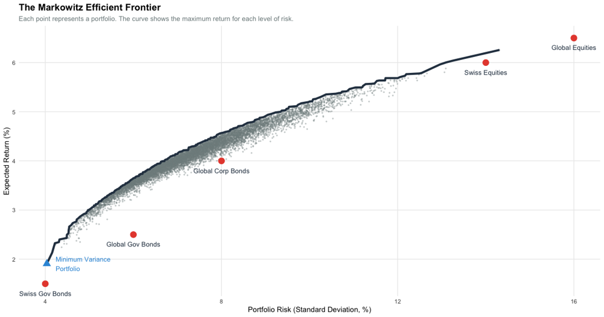

With the client and the market understood, the next step is the strategic allocation, the
benchmark against which every tactical decision is measured. The strategic allocation is entered once per fund on the Investment strategy page and stays for
the whole game. It is the **benchmark**: risk-adjusted performance, attribution and the strategic
allocation analysis on the Analyst page are measured against it. The game also holds, invisibly,
the allocation its parameters say is optimal for the client; the closer your strategic allocation
is to it, the better the client is served.

<!-- The old text "That optimal allocation is defined, and the definition is public:" was a little confusing to me. Does it meant the same as my new sentence or was there a different intention behind it? -->
That optimal allocation is the solution to a quadratic optimisation problem:

::: {.callout-important title="The definition of a client's strategic allocation"}
Maximise expected excess return minus γ/2 times the variance of the portfolio over the 16
benchmark positions (government bonds, corporate bonds and equities in five currencies, plus
commodities; no money market), with μ and Σ the sample mean and covariance of the full history
(monthly, in US dollars, unhedged, in excess of the US money-market rate, annualised: mean × 12,
covariance × 12), long-only, fully invested, under the client's rules. Nothing else. Weights are
rounded to half a percent.
:::

So the task is not to invent an allocation. It is to estimate γ well (Chapter 2) and run the
optimisation on the right data.

## What the optimiser is doing

The objective above is **mean–variance optimisation** (MVO), the framework introduced by Markowitz in 1952. It is worth a moment on what it does, because the output only makes sense if you know what the
optimiser is trying to achieve.

Every candidate portfolio has two summary numbers. Its **expected excess return** is the weighted average of the excess returns of its holdings. Its **variance** is not just the weighted average of the holdings' variances: it also depends on how the holdings move together (their covariances). Two assets that move in lockstep diversify nothing; two that move independently partly offset each
other. That is the whole point of diversification, and it is the reason the optimiser does not simply pile into the single highest-return asset.

Plot every possible portfolio in (volatility, expected return) space and you get a cloud. The upper-left edge of that cloud is the **efficient frontier**: the portfolios that offer the most expected return for their level of risk. Any portfolio below the frontier is dominated: another portfolio offers more return for the same
risk, or less risk for the same return. The optimiser finds the frontier and then picks the one point on it that the client's $\gamma$ selects. A higher $\gamma$ pushes the choice down and to the left (quieter, lower return); a lower $\gamma$ pushes it up and to the right (riskier, higher return).

{#fig-efficient-frontier}

Two consequences follow, and both matter for the checks:

- **The allocation is a point on the frontier, not a forecast.** It says "given these inputs and this $\gamma$, this is the best trade-off available." It does not say which asset class will win next year.
- **MVO is sensitive to its inputs.** Small changes in expected returns or in the covariance matrix can move the optimal weights a long way, sometimes into concentrated positions. That is why the checks below look not only at the weights but at what the optimiser chose to leave at zero.

## Station 2 of the app, step by step

1. **Client box.** Enter your estimate of γ (whole numbers). Pick the home market from *Meet
   client X* and set the share at home to what the card says. Objective: *Quadratic utility*.
   Give the run a label, e.g. "Hartley, UK".
2. **Limits by asset class.** Commodities: min = the floor, or max 0 if the client holds none.
   Leave everything else at 0 and 1.
3. **Limits by currency and per position.** Leave at 0 and 1 unless the card says otherwise.
   The optimiser decides.
4. **Optimise.** Read the matrix.
5. **Check** (below). If it passes, **Fix this allocation as an SAA**; it is now available to the
   tactical stations.
6. **Enter it in the game**: Investment strategy → Strategic allocation, the currency × asset
   class grid, in percent. Commodities go into the USD column.

## Worked example: the Hartleys

Inputs: γ = 8, home UK with half of the equity book at home, commodities ≥ 5 %. Output, as the
game shows it:

| | USD | GBP | EUR | CHF | JPY | Total |
|:--|--:|--:|--:|--:|--:|--:|
| Government bonds | 38.0 | 0 | 0 | 0 | 0 | 38.0 |
| Corporate bonds | 10.5 | 0 | 0 | 0 | 0 | 10.5 |
| Equities | 17.0 | 23.0 | 3.5 | 1.5 | 1.5 | 46.5 |
| Commodities | 5.0 | 0 | 0 | 0 | 0 | 5.0 |
| Total | 70.5 | 23.0 | 3.5 | 1.5 | 1.5 | 100.0 |

In-sample results of these fixed weights, rebalanced monthly: expected excess return 6.4 %,
volatility 7.5 %, Sharpe ratio 0.85, worst calendar year −13.9 %, maximum drawdown −22 %.
Binding limit: the commodity floor. Home share of the equity book: 49 % (50 % before rounding).

Read the matrix as the client will. The defensive part of the fund is in dollars. The equity book
is half British, and the other half follows the capitalisation of the remaining markets, which
puts the United States first. Everything the card did not ask for is zero.

## The checks before you fix it

- **The rules are met and nothing else binds.** The station lists the binding limits; for a
  well-read client only the floor you entered appears.
- **Inside the guidance bands.** For the Hartleys the card quotes government bonds 15–52 %,
  corporate bonds 6–18 %, equities 37–63 %. The example sits inside all three. If a class is
  outside its band, your γ is outside the bracket: move it toward the middle.
- **Home share of the equity book as stated.** Rounding moves it by a point.
- **Plausible risk.** Worst year and drawdown should fit the words on the card. The Hartleys
  "would not want to see a year like 2008 again"; a worst year of −14 % in thirty years is
  consistent with that, a worst year of −23 % is not.
- **Look at what is zero.** If a position with a Sharpe ratio near zero in station 1 appears in
  the allocation, a limit is forcing it. Ask which.

## What a wrong γ costs

Distance is half the sum of absolute weight differences to the benchmark, in points. For the
Hartleys, whose benchmark is the γ = 8 allocation above:

| γ chosen | 5.5 | 6 | 7 | **8** | 9 | 10 | 11 |
|:--|--:|--:|--:|--:|--:|--:|--:|
| Equities % | 62.5 | 58.5 | 51.5 | **46.5** | 43 | 40 | 37 |
| Government bonds % | 15 | 21 | 31 | **38** | 43.5 | 48 | 52 |
| Volatility % | 10.0 | 9.4 | 8.3 | **7.5** | 7.0 | 6.6 | 6.2 |
| Worst year % | −23 | −21 | −17 | **−14** | −12 | −10 | −8 |
| Distance to the benchmark, points | 23 | 17 | 7 | **0** | 5.5 | 10 | 14 |

The cost is continuous. An estimate one point off costs 5 to 7 points of allocation; the ends of
the bracket cost 14 to 23. This is the score of the "know your client" step. Note also how the
worst year moves with γ: the risk words on the card are a second way to place γ in the bracket.

## Traps

**Maximum Sharpe ratio and minimum variance.** Neither is the client's allocation; the client is
defined by γ. Both objectives in the app are for comparison only, and with the money-market
positions added to the selection they collapse into cash.

**Shortening the sample.** The benchmark is defined on the full history. A shorter window moves
every number.

**Adding limits the card does not state.** A cap on one equity market, a floor on home bonds, a
currency limit, a cash floor: each moves the allocation away from the benchmark and is a bet the
client did not ask for.

**Entering the matrix wrongly.** The game's grid is currency × asset class. Commodities are a USD
position. Check that each column and row sums to the app's totals.

## Deliverable of this step

Per fund: the SAA fixed in the app, the same matrix entered in the game, and a one-line record of
the inputs (γ, rules, home) in the team forum, so that the tactical stations and the results
discussion refer to the same thing all game. Save the app session as well (*Save*, a JSON file);
*Load* restores the SAAs in a later round.

