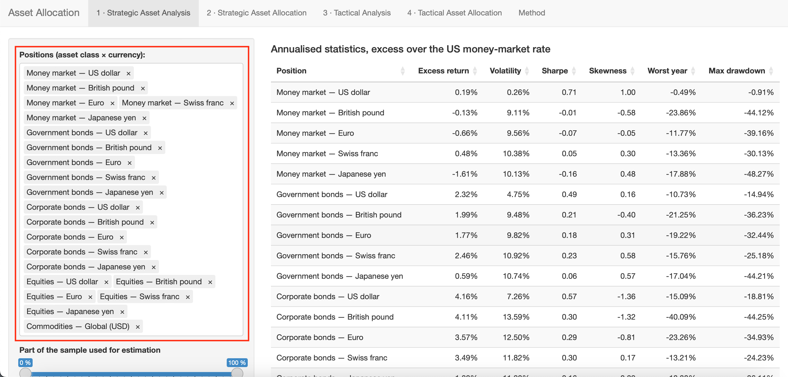
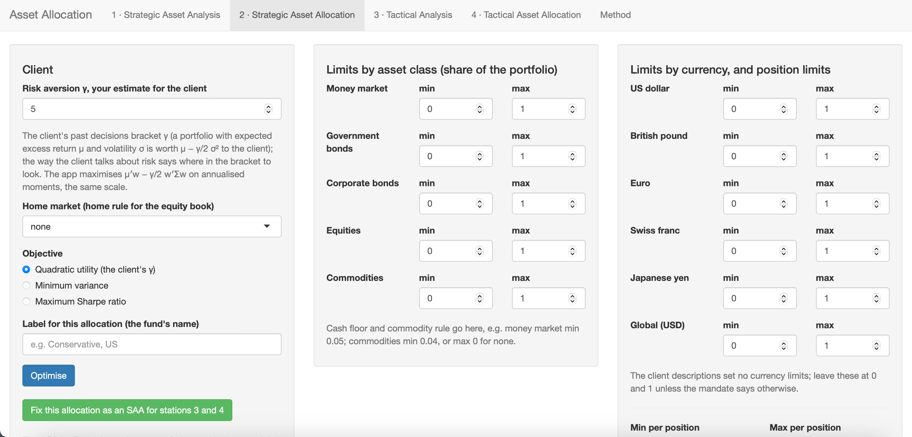
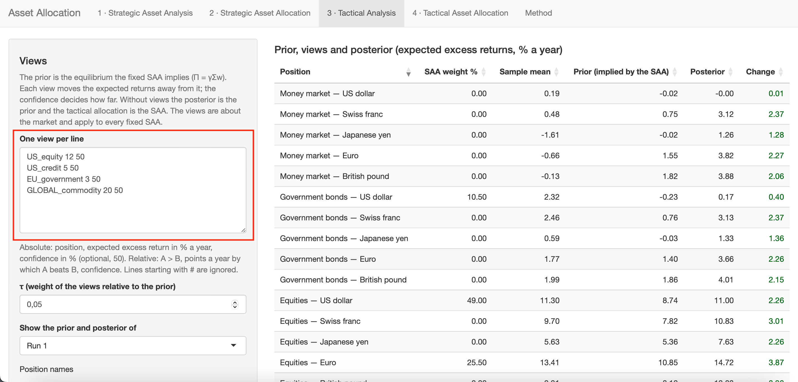
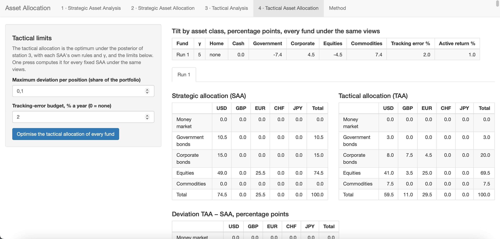

This course provides an online application that implements the allocation methods explained in this handbook.
Using the course dataset, the app automatically computes the strategic and tactical allocations. Transfer the values from the game to the app to calculate the allocations. Four stations guide you through the process, each corresponding to a chapter in the handbook.

Access the application at: <https://inno.uni.li/apps/invest/>.

## Station 1: Strategic Asset Analysis
Specify the investment fund's asset universe. Leaving this setting unchanged is recommended: the default selection is the 16 benchmark positions, all of which the game lets you invest in. For the selected assets, the app computes annualised statistics, the correlation matrix, and the cumulative log return.

The five money-market positions are not part of the benchmark, so the default selection leaves them out. Add them only to study cash: for a foreign money-market position, most of the return and almost all of the risk come from the exchange rate.

## Station 2: Strategic Asset Allocation
Based on the supplied inputs, Station 2 optimises the fund's strategic allocation. This quadratic programme maximises the portfolio's expected return while minimising its risk, subject to several constraints. As introduced in Chapter 4, the method follows the Markowitz mean–variance optimisation framework. Additional constraints account for the home market and home share, as well as floors and caps for asset classes, currencies, and individual positions.

For each fund, specify the risk-aversion parameter (γ), the home market, the home share, and the objective function: quadratic utility, minimum variance, or maximum Sharpe ratio. Optimal weights for each asset class and currency are then computed subject to the specified constraints.

With these inputs, the app solves the following optimisation problem:

$$
\max_w \; \mu' w - \frac{\gamma}{2}\, w' \Sigma w
\quad \text{s.t.} \quad \sum w = 1,\; w \ge 0,\; \text{floors and caps},\; \text{home rule},
$$

with the home rule as one linear equality per foreign equity market: $w_x = (1-h)\, s_x
\sum_{\text{equity}} w$, where $h$ is the home share and $s_x$ the capitalisation share of the market
$x$ outside the home market.

## Station 3: Tactical Analysis
Before calculating the tactical allocation, specify views on the expected returns of the assets. Views can be absolute or relative and can include a confidence level.

Use the following syntax for the views:

- Positions are named `<region>_<class>`: `US_money_market`, `UK_government`, `EU_credit`,
`CH_equity`, `JP_equity`, `GLOBAL_commodity`

    - Money market: `US_money_market`, `UK_money_market`, `EU_money_market`, `CH_money_market`, `JP_money_market`
    - Government bonds: `US_government`, `UK_government`, `EU_government`, `CH_government`, `JP_government`
    - Corporate bonds: `US_credit`, `UK_credit`, `EU_credit`, `CH_credit`, `JP_credit`
    - Equities: `US_equity`, `UK_equity`, `EU_equity`, `CH_equity`, `JP_equity`
    - Alternatives: `GLOBAL_commodity`

- Absolute view: `<position> <expected return> [confidence]` (e.g., `US_equity 12 50` means that US equities are expected to earn 12% a year over cash, with a confidence of 50%)
- Relative view: `<position1> > <position2> <expected return difference> [confidence]` (e.g., `EU_equity > CH_equity 2 60` means that euro-area equities are expected to beat Swiss equities by 2 points a year, with a confidence of 60%)
- Enter each view on a new line. Lines starting with `#` are ignored. A list of position names is available in the panel.

Parameter τ controls the weight assigned to the views during optimisation. Based on the specified views and strategic allocation, the app computes the prior and posterior expected returns.

These views produce the priors and posteriors through the He–Litterman (1999) model.

- **Prior** — the baseline expected returns implied by the strategic allocation, *before* any tactical views. Reverse optimisation obtains it from $\Pi = \gamma \Sigma w_{\text{SAA}}$: the SAA weights are treated as if they were optimal, and the returns that would justify them are backed out. The prior therefore anchors the analysis to the long-term allocation.
- **Posterior** — the updated expected returns *after* incorporating the views. The Black–Litterman formula blends the prior (weighted by $\tau\Sigma$, reflecting uncertainty in the prior) with the views $Q$ (weighted by $\Omega$, reflecting confidence in each view). High-confidence views move returns further from the prior; low-confidence views barely move them. In the positive-semidefinite sense, posterior covariance $\Sigma_{BL}$ exceeds $\Sigma$ because it adds estimation uncertainty to market risk.

<!--

To AI Agent and Sebastian I decided to leave this out, maybe we should reintroduce it later. It is a bit technical and the app does not show it, but it is important to understand the underlying math. However I'm not aware of a way on how to present it without being too technical.

**Mathematically:**

Prior:

$$
\Pi = \gamma \Sigma w_{\text{SAA}}
$$

This is the reverse optimisation with the SAA's own $\gamma$ and the unrounded weights — i.e., the expected return implied by the strategic asset allocation before any tactical views.

Posterior (He–Litterman 1999):

$$
\mu_{BL} = \left[(\tau\Sigma)^{-1} + P'\Omega^{-1}P\right]^{-1}
          \left[(\tau\Sigma)^{-1}\Pi + P'\Omega^{-1}Q\right],
\qquad
\Sigma_{BL} = \Sigma + \left[(\tau\Sigma)^{-1} + P'\Omega^{-1}P\right]^{-1},
$$

where $\Omega$ is diagonal and

$$
\Omega_k = \frac{1-c_k}{c_k}\,\tau\, p_k'\Sigma p_k,
$$

so that $c = 1/2$ is the He–Litterman setting.

-->

## Station 4: Tactical Asset Allocation
In the final step, translate the short-term views into a tactical allocation. Define the Strategic Asset Allocation (SAA) and the Tactical Analysis before computing the Tactical Asset Allocation (TAA). Solving an optimisation problem similar to the one in Station 2 produces the TAA, using the posterior expected returns and covariance matrix from Station 3, together with constraints on the maximum deviation per position and the tracking-error budget.

Specify the maximum deviation per position (the band; default: 0.05) and the tracking-error budget (default: 2\% per year; 0 means no tracking-error constraint). Optimal weights for each asset class and currency are then computed subject to the specified constraints. This budget represents the maximum permitted deviation from the strategic allocation, measured as the standard deviation of the difference between the tactical and strategic allocations using the covariance matrix.

Omitting the home rule preserves the benchmark. Retaining it would prevent a view on an
individual equity market from affecting the allocation. Risk is measured with the sample covariance
Σ rather than $\Sigma_{BL}$; the latter adds estimation uncertainty and could shift weights
independently of the views. If the tracking error
$\sqrt{(w - w_{\text{SAA}})'\Sigma(w - w_{\text{SAA}})}$ exceeds the budget, the deviation is
scaled to the budget.

<!--

## What it is

A Shiny app, provided with the course, that runs the allocation method of this book on the course
dataset. It has four stations that follow Chapters 3 to 6. It does not connect to the game; you
read numbers off it and type them into the game's grids.

Source and installation: the course repository (`2024_CESIM_Invest`). It needs R with the packages
`shiny`, `DT`, `xts` and `quadprog`; start it with `shiny::runApp()` in the app folder, or use the
hosted instance your instructor names.

## The data

- `data/classes_monthly.csv`: the 21 positions, monthly total returns in US dollars, unhedged,
  with an index series; the full history the course uses. The strategic benchmark is defined on
  the 16 positions without the money market; the app's default selection leaves the five
  money-market positions out, and they can be added for analysis.
- `data/riskfree_monthly.csv`: the US money-market rate, monthly.
- `data/cap_shares.csv`: the capitalisation shares of the five equity markets, for the home rule.

Positions are named `<region>_<class>`: `US_money_market`, `UK_government`, `EU_credit`,
`CH_equity`, `JP_equity`, `GLOBAL_commodity`. Excess returns are total returns minus the
money-market rate of the same month. Annualisation: mean × 12, covariance × 12.

## Station 1: Strategic Asset Analysis

Inputs: the positions (default: the 16 benchmark positions) and the proportion of the sample to
use (default: all observations). Outputs: annualised statistics (excess return, volatility, Sharpe
ratio, skewness, worst calendar year, maximum drawdown), the correlation matrix, and the growth of 100.

## Station 2: Strategic Asset Allocation

Inputs: γ (whole numbers), home market and home share, objective (quadratic utility, minimum
variance, maximum Sharpe), a label; floors and caps by asset class, by currency and per position.
The problem solved:

$$
\max_w \; \mu' w - \frac{\gamma}{2}\, w' \Sigma w
\quad \text{s.t.} \quad \sum w = 1,\; w \ge 0,\; \text{floors and caps},\; \text{home rule},
$$

with the home rule as one linear equality per foreign equity market: $w_x = (1-h)\, s_x
\sum_{\text{equity}} w$, where $h$ is the home share and $s_x$ the capitalisation share of market
$x$ outside the home market. Solved with `quadprog::solve.QP(D = \gamma\Sigma, d = \mu, A, b,
meq)`. Minimum variance sets μ = 0; maximum Sharpe is the best point of a sweep over γ. Weights are
rounded to half a percent, the residual into the home equity position.

Outputs: the allocation as a currency × asset class matrix with sums, the positions with raw and
rounded weights, class and currency totals, in-sample results of the fixed weights rebalanced
monthly (expected excess return, volatility, Sharpe, best and worst calendar year, maximum
drawdown), the binding limits, the in-sample path, the efficient frontier under the same limits,
the constraint rows, and R code that reproduces the run. Selecting *Fix this allocation as an SAA*
makes it available to Stations 3 and 4. Several SAAs can be fixed, each with a separate label.

## Station 3: Tactical Analysis

Inputs: τ (default: 0.05) and the views, entered one per line. For example, `US_equity 12 50` is an absolute view
(US equities earn 12 % a year over cash, confidence 50 %); `EU_equity > CH_equity 2 60` is a
relative view (euro-area equities beat Swiss equities by 2 points a year, confidence 60 %). The
confidence is optional and defaults to 50%; lines starting with `#` are ignored; a list of position
names is available in the panel. The views apply to every fixed SAA; a selector determines which
SAA's prior and posterior the table displays.

Prior: $\Pi = \gamma \Sigma w_{\text{SAA}}$ (reverse optimisation with the SAA's own γ and the
unrounded weights). Posterior (He–Litterman 1999):

$$
\mu_{BL} = \left[(\tau\Sigma)^{-1} + P'\Omega^{-1}P\right]^{-1}
          \left[(\tau\Sigma)^{-1}\Pi + P'\Omega^{-1}Q\right],
\qquad
\Sigma_{BL} = \Sigma + \left[(\tau\Sigma)^{-1} + P'\Omega^{-1}P\right]^{-1},
$$

where $\Omega$ is diagonal and $\Omega_k = \frac{1-c_k}{c_k}\,\tau\, p_k'\Sigma p_k$, so that c = 1/2
is the He–Litterman setting. Outputs: per position the SAA weight, the sample mean, the prior, the
posterior and the change; the views as parsed.

## Station 4: Tactical Asset Allocation

Inputs: the maximum deviation per position (band, default: 0.05) and the tracking-error budget
(default: 2% per year; 0 means no tracking-error constraint). One press computes the tactical
allocation of **every** fixed SAA under the same views. For each SAA, the app solves the Station 2
problem using $(\mu_{BL}, \Sigma)$ with that
SAA's γ and limits but without the home rule, plus
$w_{\text{SAA}} - d \le w \le w_{\text{SAA}} + d$. The home rule is left out because it defines
the benchmark. If the home rule were retained, a view on an individual equity market could not
affect the allocation. The sample covariance Σ is used,
not $\Sigma_{BL}$: $\Sigma_{BL}$ raises the measured risk by about $(1+\tau)$ as soon as any view
is entered and moves weight from equities into bonds for reasons unrelated to the views. If a budget is
set and the tracking error $\sqrt{(w - w_{\text{SAA}})'\Sigma(w - w_{\text{SAA}})}$ exceeds it,
the deviation is scaled to the budget. Outputs: a summary table with the tilt by asset class,
tracking error and active return per fund, and a tab per fund with the SAA, TAA and deviation
matrices, the active-position figures and the binding limits. A negative expected active return
is flagged in both. If the home rule is non-binding, the TAA equals the SAA without views, and a view that agrees with
the prior leaves it unchanged. If removing the home rule relaxes a binding constraint, the TAA may
differ even without views.

## Saving your work

Station 2 saves the fixed SAAs (their inputs and weights), the views and the tactical settings as a
JSON file and loads such a file back. On loading, the SAAs are recomputed from their inputs on the
current data, so a loaded file is always consistent with the dataset in use. Save the file in the
team forum; it is the team's record of the funds and views.

## Tests

`tests/check_recipe.R` confirms that the app's constraint builder and solver reproduce a
hand-written quadratic programme for twenty client cases; `tests/check_taa.R` confirms that the
tactical allocation equals the strategic one without views and under a view that agrees with
the prior, that a negative view on one equity market lowers that market, and shows one view at
work with a tracking-error budget.

-->